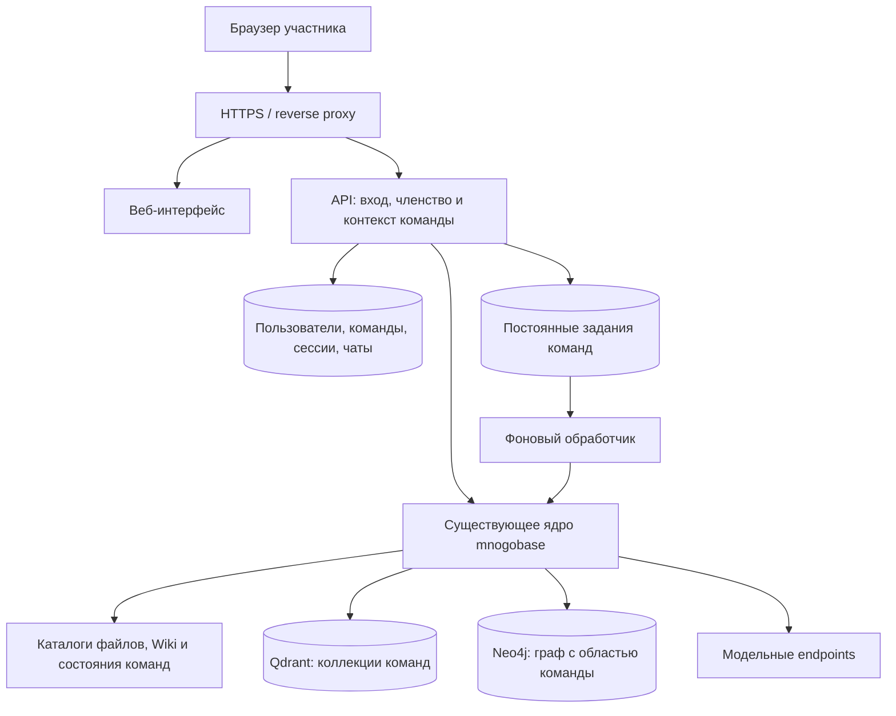

# mnogobase: план развития командного веб-сервиса

Дата среза: **2 ноября 2026 года**.

Документ описывает текущее состояние репозитория и переход к демонстрационному веб-сервису на VPS. Он служит основой для реализации: перечисляет готовые компоненты, необходимые изменения, порядок работ и критерии приёмки. Перечисленные будущие модули и HTTP-маршруты ещё не реализованы.

## 1. Какой продукт делаем

Пользователь входит на сайт, выбирает свою команду и работает с её базой знаний: загружает документы, ищет информацию, задаёт вопросы с цитированием источников, читает автоматически сформированную Wiki и исследует связи в графе.

### Согласованные требования

- Приложение размещается на VPS, доступ осуществляется через браузер.
- Первый релиз — демо минимум для **двух независимых команд**.
- Каждая команда имеет собственную базу знаний.
- Все участники одной команды могут видеть все документы этой команды.
- Материалы разных команд изолированы, в том числе при поиске и генерации ответа.
- Число команд не зашивается в код как константа `2`.
- Существующее ядро `mnogobase` используется как основа.

### Предложения для первой версии

Следующие решения рекомендуются для небольшого демо, но не являются ранее согласованными требованиями:

- Одно приложение и один VPS, общие сервисы Qdrant и Neo4j с разделением данных команд.
- Backend на FastAPI, frontend на React и TypeScript, HTTPS через Caddy.
- Аккаунты и команды создаёт оператор сервиса; самостоятельной регистрации в демо нет.
- Пользователь может состоять в нескольких командах; переключатель показывает только доступные ему команды.
- Две роли: администратор команды и участник. Оба читают все документы; участник загружает материалы и задаёт вопросы, администратор дополнительно удаляет документы и управляет участниками.
- Диалоги личные для автора, но используют общую базу выбранной команды. Совместные чаты можно добавить позже.
- Сначала переиспользуются доступные модельные endpoints. Покупка VPS с GPU и полностью автономный запуск моделей не являются обязательным условием демо.

## 2. Что уже реализовано

«Есть» в таблице означает наличие реализации в ядре и CLI. Это не означает, что функция уже доступна через сайт или поддерживает несколько команд.

| Возможность | Состояние | Где реализовано / ограничение |
|---|---|---|
| Импорт документов | Есть | [DoclingParser](../src/mnogobase/parsing/docling_parser.py): PDF, DOCX, PPTX, XLSX, HTML, Markdown, CSV, TXT, изображения и другие настроенные расширения |
| OCR и описания изображений | Есть | OCR и VLM превращают содержимое изображений в текст для дальнейшей обработки |
| Структурный чанкинг | Есть | [chunking](../src/mnogobase/chunking/hybrid.py), учёт заголовков, страниц и токенов |
| Vector + keyword search | Есть | [RagRetriever](../src/mnogobase/retrieval/rag.py): dense + BM25, RRF, соседние чанки, опциональный reranker |
| Извлечение сущностей и связей | Есть | [extraction](../src/mnogobase/extraction/extractor.py), объединение RU/EN-сущностей через resolver |
| Knowledge Graph | Есть | [GraphStore](../src/mnogobase/stores/graph_store.py), хранение в Neo4j |
| Поиск с использованием графа | Есть | [GraphRetriever](../src/mnogobase/retrieval/graph.py): стартовые сущности, окрестность связей, чанки-доказательства |
| Постоянная Wiki | Есть | [WikiBuilder](../src/mnogobase/wiki/builder.py): страницы сущностей, ссылки, источники, инкрементальная пересборка |
| Поиск по Wiki | Есть | [WikiRetriever](../src/mnogobase/retrieval/wiki.py): поиск по разделам и добавление процитированных исходных чанков |
| Ответы с цитатами | Есть | [Answerer](../src/mnogobase/retrieval/answer.py): источник, путь, страница и идентификатор контекста |
| Четыре режима ответа | Есть | `rag`, `wiki`, `graph`, `all`; общий механизм генерации ответа |
| Инкрементальное обновление | Есть | [pipeline](../src/mnogobase/pipeline.py), [registry](../src/mnogobase/registry.py), пропуск завершённых этапов, обработка изменённых файлов |
| Удаление знаний об источнике | Есть | [removal](../src/mnogobase/removal.py), каскадное удаление и пересборка затронутой Wiki |
| Очередь, повторы и восстановление | Есть | [background](../src/mnogobase/background/queue.py): постоянная SQLite-очередь, watcher, worker, прогресс, восстановление после прерывания |
| Локальные модели | Поддерживаются | [serving](../src/mnogobase/serving.py), llama.cpp / vLLM; текущая основная LLM настроена как внешний API |
| Сравнение режимов | Есть | `compare`, [evaluation](../src/mnogobase/evaluation/core.py), пять метрик Ragas, парные сравнения и отчёты |
| Измерения обработки | Есть | [processing](../src/mnogobase/processing.py): время build/update, этапы и часть расхода токенов |
| Защита границ промптов | Есть базовые меры | [templates](../src/mnogobase/llm/templates.py), разделение ролей, политика недоверенных данных и регрессионные проверки; полной защиты от prompt injection это не гарантирует |

### Ограничения готового ядра

- Основной пользовательский интерфейс — CLI. Wiki и граф можно читать через внешние инструменты, включая Obsidian и Neo4j Browser.
- `ask` обрабатывает отдельный вопрос; полноценной истории диалога и обработки уточняющих реплик нет.
- Wiki преимущественно строится вокруг сущностей. Автоматического сохранения результатов исследования как новых обзорных страниц нет.
- Исчезновение файла не запускает удаление знаний автоматически: нужна операция `remove --missing`.
- Изображения ищутся через текстовые описания. Нативные image/audio embeddings не реализованы.
- Существующая очередь ориентирована на ingest. Фоновое удаление, сравнение и другие операции потребуют дополнительных обработчиков.
- Текущие хранилища и идентификаторы не обеспечивают изоляцию нескольких команд сами по себе.
- Наличие цитаты подтверждает ссылку на контекст, но не доказывает правильность каждого утверждения LLM.

Подробности существующего поведения: [README](../README.md), особенно разделы 5, 13, 14 и 15.

## 3. Что нужно реализовать для демо

| Блок | Что добавить | Приоритет |
|---|---|---|
| Команды и доступ | Пользователи, команды, членство, роли, вход и выход | P0 |
| Изоляция данных | Разделение файлов, векторов, графа, кэшей, очередей и результатов | P0 |
| Серверный API | Операции с документами, поиском, ответами, Wiki, графом и заданиями | P0 |
| Документы на сайте | Загрузка, список, состояние обработки, ошибка, повтор, удаление | P0 |
| Поиск на сайте | Найденные фрагменты, источник, страница, переход к материалу | P0 |
| Чат | Сохранение диалогов, выбор режима, ссылки на источники | P0 |
| Просмотр Wiki | Список страниц, содержимое, внутренние ссылки, источники | P0 |
| Просмотр графа | Поиск узла, раскрытие соседей, предикаты, доказательства связи | P0 |
| Развёртывание | Полный Compose, HTTPS, секреты, постоянные тома, перезапуск | P0 |
| Проверки демо | Два корпуса, тесты доступа и живой сквозной сценарий | P0 |
| Сравнение в интерфейсе | Запуск режимов рядом, история и отображение готовых оценок | P1 |
| Knowledge gaps и противоречия | Анализ состояния базы и очередь вопросов для исследования | Следующий этап |
| Deep Research | Автоматический поиск и проверка недостающих внешних источников | Следующий этап |
| MCP | Доступ внешних AI-агентов к разрешённой командной базе | Следующий этап |

P0 — обязательное условие законченного демо. P1 — полезное расширение после рабочего сквозного сценария. Демо без knowledge gaps и Deep Research не следует представлять как полную реализацию исходного PRO-сценария.

## 4. Предлагаемая архитектура

### Почему этот вариант

Общее приложение и общие хранилища сокращают число сервисов на VPS, но требуют доработать все операции ядра для изоляции команд. Альтернатива — отдельные экземпляры хранилищ для каждой команды: меньше изменений в существующих запросах, больше расход ресурсов и операций обслуживания. Для демо предлагаем первый вариант; он ещё не реализован и не подтверждён нагрузочным тестом.

Для учётных записей и чатов небольшого демо можно использовать отдельную SQLite-БД сервиса при одном процессе API. Её нельзя смешивать с registry обработки документов. PostgreSQL и несколько экземпляров API рассматриваются при расширении нагрузки; менять рабочий registry только ради веб-интерфейса не требуется.

API не вызывает CLI как shell-команду с пользовательскими аргументами. Операции получают типизированные параметры и используют Python-сервисы поверх существующего `build_app`.

## 5. Изоляция команд: обязательная часть реализации

### 5.1 Контекст команды

После входа API проверяет членство и создаёт серверный `TeamContext`. Он передаётся во все операции с базой. Переданный браузером `team_id` — только запрос на выбор команды, а не доказательство доступа.

Рекомендуемая модель служебных данных:

- `User`: учётная запись и состояние доступа.
- `Team`: идентификатор и название команды.
- `Membership`: связь пользователя с командой и роль; уникальная пара «пользователь + команда».
- `Session`: серверная сессия с возможностью отзыва.
- `Conversation` и `Message`: команда, автор, вопрос, ответ, режим и сохранённые ссылки на источники.

Автор диалога проверяется отдельно от членства в команде. Общая видимость документов не означает автоматической общей видимости личных чатов.

### 5.2 Границы хранения

| Слой | Предлагаемое разделение |
|---|---|
| Исходные документы | `data/teams/<team_id>/documents/`, имя на диске назначает сервер |
| Registry, кэш и блокировки | `data/teams/<team_id>/state/`, отдельные `state.db`, `jobs.db`, `ingest.lock`, `worker.lock` |
| Wiki | `data/teams/<team_id>/wiki/` |
| Результаты экспериментов | `data/teams/<team_id>/runs/` |
| Qdrant | Отдельный набор коллекций на команду через существующий `prefix` |
| Neo4j | `team_id` у узлов и ограничение всех операций областью команды |
| Чаты и служебные задания | Явная принадлежность команде; для чатов также автору |
| Доступные пользователю логи | Фильтрация по команде, без ключей и необработанных ответов провайдера |

`team_id` и Qdrant prefix формируются из серверного реестра команд. Пользователь не задаёт произвольные префиксы, пути или адреса хранилищ.

### 5.3 Детерминированные идентификаторы

Существующие `doc_id`, `chunk_id`, `entity_id`, `page_id` и Qdrant point id детерминированы. Одинаковые данные у двух команд закономерно дадут одинаковые локальные идентификаторы.

Нужно сохранить идемпотентность внутри команды и добавить область владения вокруг идентификатора:

- В Neo4j уникальность, `MATCH`, `MERGE`, traversal и удаление учитывают пару «команда + локальный идентификатор».
- Глобальные ограничения уникальности из текущего `_SCHEMA` требуют миграции.
- В отдельных Qdrant-коллекциях одинаковые point id разных команд не пересекаются.
- Entity resolution не ищет кандидатов на слияние в другой команде.
- Связи и их evidence могут ссылаться только на узлы и чанки той же команды.
- Индексная сигнатура эмбеддера, кэш извлечения, dirty-очередь и журнал удаления остаются в состоянии своей команды.

Недостаточно добавить `team_id` только в таблицу документов. В [GraphStore](../src/mnogobase/stores/graph_store.py) есть глобальные операции, включая `wipe`, `counts`, полнотекстовый поиск, чтение Wiki и обход графа; их тоже необходимо ограничить командой. Полнотекстовый поиск проверяется на полноту результатов своей команды, а не только на отсутствие чужих результатов после фильтрации.

### 5.4 API, цитаты и фоновые операции

- Проверять доступ при чтении документа, страницы Wiki, узла, связи, задания, отчёта и вложения.
- Отдавать источники через авторизованный маршрут, а не через открытый каталог `data/`.
- Преобразовывать внутренние пути цитат в серверные ссылки; не показывать пользователю пути файлов VPS.
- Хранить команду в задании и восстанавливать тот же контекст при повторе и после перезапуска.
- При переключении команды отменять устаревшие запросы сайта, очищать прежние результаты и учитывать команду в ключах клиентского кэша.
- Ограничивать сброс, переиндексацию, пересборку и удаление выбранной командой.
- Не менять глобальный `cwd`, окружение или общий объект `Settings` ради текущего HTTP-запроса. Командные пути задавать явно.
- Не разделять между конкурентными запросами изменяемое состояние registry и счётчики LLM usage без определённого жизненного цикла и синхронизации.

### 5.5 Подключение существующих данных

Перед миграцией сделать резервную копию. Существующую однопроектную базу можно назначить одной команде либо оставить отдельным legacy-проектом. Назначение владельца выполняет оператор явно; пользователи не получают старые данные автоматически.

После миграции проверить ограничения графа, векторные коллекции, пути Wiki, цитаты и возобновление заданий. Прежний CLI сохранить как операторский инструмент с явным выбором командного проекта; запуск глобального `reset` против общего графа недопустим.

## 6. Сайт и пользовательские сценарии

| Экран | Содержимое | Обязательные состояния |
|---|---|---|
| Вход и выбор команды | Вход, выход, список доступных команд, текущая команда | Ошибка входа, истёкшая сессия, отсутствие членства |
| Документы | Список, загрузка, размер, автор, обработка, повтор, удаление | Пустая база, загрузка, дубликат, ошибка, ожидание, готовность |
| Поиск | Запрос, фрагменты, источник и страница | Нет результатов, ошибка, база обновляется |
| Чат | История, вопрос, режим, ответ, цитаты | Ожидание, ошибка модели, отсутствие источников, удалённый источник |
| Wiki | Список страниц, страница, внутренние ссылки, источники | Пока нет страниц, пересборка, отсутствующая страница |
| Граф | Поиск концепта, ограниченный подграф, раскрытие соседей, evidence | Нет узла, нет связей, достигнут лимит, ошибка |
| Администрирование | Участники, роли, задания и состояние команды | Нет прав, недоступный сервис, ошибка задания |

Интерфейс демо — на русском. Сгенерированный текст следует настройкам языка ядра. Wiki и ответы отображаются как Markdown с безопасной обработкой ссылок и HTML.

Основной сценарий: **вход → выбор команды → загрузка → обработка → поиск или вопрос → цитата → исходный материал**. Загрузка завершается постановкой задания; закрытие вкладки не отменяет обработку.

Для диалога недостаточно хранить сообщения: нужно определить, как предыдущие реплики влияют на новый запрос. Предлагается разрешать уточнение вопроса по ограниченной истории перед retrieval, а фактическое обоснование ответа получать из текущих источников команды. Другой чат или команда не входят в историю запроса.

Потоковая выдача ответа — улучшение после работающего обычного ответа. Текущий `LLMClient` нельзя считать автоматически готовым к streaming.

## 7. Предлагаемые группы API

Это эскиз будущего контракта, а не список работающих endpoints.

| Группа | Операции |
|---|---|
| `/api/auth/...` | Вход, выход, состояние сессии |
| `/api/teams` | Доступные пользователю команды |
| `/api/teams/{team_id}/members` | Участники и роли, управление для администратора |
| `/api/teams/{team_id}/documents` | Список, загрузка, состояние, удаление |
| `/api/teams/{team_id}/documents/{id}/content` | Авторизованное получение исходного файла |
| `/api/teams/{team_id}/search` | Найденные фрагменты и метаданные источников |
| `/api/teams/{team_id}/conversations/...` | Личные диалоги и сообщения в контексте команды |
| `/api/teams/{team_id}/wiki/...` | Список и чтение страниц, сборка по разрешённой операции |
| `/api/teams/{team_id}/graph/...` | Поиск узлов, ограниченная окрестность, подтверждения |
| `/api/teams/{team_id}/jobs/...` | Прогресс, состояние и повтор разрешённого задания |
| `/api/teams/{team_id}/experiments/...` | Сравнение и отчёты; расширение после P0 |

Для списков нужны ограничение размера ответа и пагинация. Для графа — лимиты глубины и числа элементов. Для загрузок — допустимые типы и размер файла. Пользовательская ошибка не должна возвращать traceback, секреты или данные другой команды.

Длительная операция возвращает идентификатор постоянного задания. Повторная отправка загрузки не должна создавать несколько независимых обработок одной ревизии: нужно использовать существующий fingerprint и определить идемпотентность HTTP-операции.

## 8. Фоновая обработка и согласованность

Существующая очередь и восстановление переиспользуются. Для демо предлагается один процесс-диспетчер, который по очереди обслуживает готовые задания команд и выполняет не более одной тяжёлой операции обработки одновременно. Планировщик должен давать второй команде возможность обработки при длинной очереди первой.

Изолированные `jobs.db` и блокировки команд сохраняются. Для работы с несколькими командами нужен новый слой диспетчеризации: текущий `worker run` обслуживает один проект. Удаление и административные операции не должны обходить общий диспетчер и командные блокировки.

Порядок обработки сохраняется: `parse → chunk → embed → extract → graph → wiki`. Этап отмечается завершённым только после записи результатов. Существующие механизмы pending removals, retry и dirty Wiki сохраняют смысл внутри своей команды.

Три хранилища не образуют одну транзакцию. Для первого демо предлагается на время изменения корпуса возвращать командным операциям поиска и ответа явное состояние «база обновляется», вместо чтения частично обновлённого набора знаний. Проверка и получение права чтения должны быть согласованы с блокировкой записи; одной проверки флага в UI недостаточно. Работа с другой командой при этом не блокируется глобально.

Отмена уже работающего задания не обещается в первой версии. Ошибки и незавершённые задания сохраняются; после перезапуска доступны восстановление и повтор.

## 9. Что изменить в существующем коде

Названия новых модулей ниже — предложение по структуре, не существующие файлы.

| Область | Доработка |
|---|---|
| [app.py](../src/mnogobase/app.py) | Создание приложения из проверенного контекста команды, управление ресурсами и жизненным циклом |
| [config.py](../src/mnogobase/config.py) | Явные командные пути, назначение Qdrant prefix, отделение общих настроек моделей от командного состояния |
| [graph_store.py](../src/mnogobase/stores/graph_store.py) | Область команды во всех запросах, миграция схемы и ограничений, защита maintenance-операций |
| [qdrant_store.py](../src/mnogobase/stores/qdrant_store.py) | Серверный выбор командных коллекций, проверка поисковых и административных операций |
| [registry.py](../src/mnogobase/registry.py) и background | Отдельное состояние команд, диспетчер, обработчики новых типов заданий |
| [pipeline.py](../src/mnogobase/pipeline.py), removal, maintenance | Сохранение инвариантов и командных границ при обновлении, удалении и сбросе |
| Retrieval, Answerer и WikiBuilder | Передача командного контекста, согласованное чтение, безопасные ссылки на источники |
| Evaluation и processing | Командные каталоги, права на результаты, контекст команды в задании эксперимента |
| Новый слой `service/` | Пользователи, членство, сессии, чаты и прикладные операции, общие для API и будущего MCP |
| Новый слой `api/` | Маршруты, авторизация, загрузки, DTO, обработка ошибок и состояние сервисов |
| Новый каталог `web/` | Веб-интерфейс, клиент API, выбор команды, документы, чат, Wiki и граф |
| Новая конфигурация deployment | Полный Compose для сервиса и VPS; существующий локальный запуск продолжает работать |

## 10. Развёртывание на VPS

### Состав

- Reverse proxy с HTTPS и доменом.
- Статическая сборка frontend.
- API и отдельный фоновый диспетчер.
- Qdrant и Neo4j.
- Постоянные тома служебной БД и данных команд.
- Подключение к нужным endpoints LLM, embeddings, reranker и VLM.

Модельные endpoints могут быть общими для команд, но запросы формируются только из данных текущей команды. Использование внешнего провайдера означает передачу выбранного контекста этому провайдеру; выбор провайдера остаётся отдельным решением.

### Обязательные работы

- Адаптировать адреса сервисов и device-настройки под Linux и выбранное оборудование.
- Убрать публичную публикацию портов хранилищ из текущего [Compose](../docker-compose.yml); оставить доступ внутри инфраструктуры сервиса.
- Задать отдельные секреты deployment, убрать демонстрационный пароль Neo4j из конфигурации публичного сервиса, не включать ключи в frontend или Git.
- Для сессий использовать защищённые cookie, отзыв доступа и защиту изменяющих запросов от CSRF; пароли хранить через поддерживаемую библиотеку хеширования.
- Ограничить объём загрузок, очереди и конкурентные модельные вызовы; показывать понятные причины отказа.
- Валидировать имена и типы файлов, исключить выход из командного каталога; не исполнять пользовательский HTML и активное содержимое в приложении.
- Настроить автоматический перезапуск, health/readiness checks, ротацию логов и контроль свободного диска.
- Сделать согласованную резервную копию служебной БД, registry, файлов, Wiki, Qdrant и Neo4j. Для демо допустима остановка записи на время копирования.
- Хранить резервные копии вне VPS и проверить восстановление на чистом окружении.
- Описать обновление, миграции и возврат к предыдущей версии приложения вместе с совместимым состоянием данных.

Точные CPU, RAM, диск и бюджет пока не зафиксированы. Их выбирают после измерения числа документов, пиков разбора, размера индексов, размещения моделей и ожидаемого числа параллельных запросов. Наличие двух команд само по себе не определяет требуемый размер VPS.

## 11. Этапы реализации

### Этап 1. Основа изоляции

- [ ] Добавить команды, пользователей, членство и серверный контекст.
- [ ] Разделить файловое состояние и Qdrant-коллекции.
- [ ] Доработать схему Neo4j и все операции графа.
- [ ] Определить миграцию существующего проекта.
- [ ] Проверить две команды с одинаковыми идентификаторами документов и сущностей.

**Готовность:** чтение, изменение и удаление данных команды A не затрагивают B, включая прямые вызовы API и maintenance-операции.

### Этап 2. API и обработка

- [ ] Реализовать вход, выход и проверку доступа.
- [ ] Подключить загрузку и постоянные задания.
- [ ] Добавить диспетчер команд и восстановление.
- [ ] Реализовать поиск, ответ и авторизованную выдачу источников.
- [ ] Определить согласованное поведение чтения при обновлении.

**Готовность:** через API проходит загрузка → обработка → вопрос → источник; перезапуск не теряет задания.

### Этап 3. Первый законченный сайт

- [ ] Вход и выбор команды.
- [ ] Документы, прогресс, ошибки и повтор.
- [ ] Поиск и просмотр фрагмента источника.
- [ ] Чаты и обработка уточняющих вопросов.
- [ ] Wiki и внутренние ссылки.
- [ ] Ограниченный граф с evidence.
- [ ] Минимальное управление участниками и удалением документов.

**Готовность:** все операции P0 выполняются через браузер, состояние выбранной команды видно на каждом рабочем экране.

### Этап 4. Развёртывание и приёмка демо

- [ ] Подготовить Compose, домен, HTTPS, тома и секреты.
- [ ] Создать две команды и демонстрационные аккаунты.
- [ ] Загрузить отдельные корпуса и одинаковый файл в обе команды.
- [ ] Пройти сквозные сценарии с реальными моделями.
- [ ] Проверить перезапуск и восстановление резервной копии.
- [ ] Добавить короткую инструкцию для участника и оператора.

**Готовность:** работающий сервис на VPS и протокол приёмки с результатами, а не только успешная локальная сборка.

### Этап 5. Эксперименты и развитие

- [ ] Добавить удобное сравнение режимов в интерфейс.
- [ ] Завершить измерения качества и затрат.
- [ ] Реализовать анализ состояния знаний.
- [ ] Подключить Deep Research и MCP после появления соответствующих прикладных операций.

## 12. Приёмка: что обязательно проверить

| Проверка | Ожидаемый результат |
|---|---|
| A и B загружают разные документы | У каждой команды свой список, Wiki, граф и поисковые результаты |
| Обе команды загружают одинаковый файл | Обработка и владение независимы; удаление в A не удаляет данные B |
| В двух корпусах есть одноимённые сущности | Entity resolution и граф не объединяют команды |
| Пользователь A подставляет `team_id` или идентификатор ресурса B | Доступ отклонён, содержимое B не раскрывается |
| Ссылка на чужую цитату, файл, отчёт или задание | Доступ отклонён на сервере |
| Подписка или опрос прогресса чужого задания | Недоступны |
| Администратор A удаляет источник или пересобирает Wiki | B продолжает работать со своими данными |
| У пользователя отзывают членство | Последующие обращения и новые события недоступны |
| Пользователь переключает команду во время запроса | Поздний ответ первой команды не появляется на экране второй |
| Модель недоступна или разбор завершился ошибкой | Понятный статус, сохранённое задание и возможность повтора |
| Worker или VPS перезапущен | Данные сохранены; незавершённые задания восстанавливаются |
| Источник ранее сохранённого ответа удалён | История явно показывает недоступность источника, не подставляет чужой материал |
| Нет релевантных источников | Ответ сообщает об отсутствии оснований в базе |
| Вопрос содержит prompt injection или документ подменяет инструкции | Выполнены структурные регрессии; живые проверки фиксируют фактические результаты и ограничения |
| Восстановление из резервной копии | Обе команды, доступы, источники и индексы работоспособны |

Проверки разделяются на unit, интеграционные с реальными Qdrant/Neo4j и браузерные E2E. Для завершённого демо нужен живой путь с реальным модельным endpoint. Наличие моков, собранного frontend или контейнеров не заменяет этот результат.

## 13. Сравнение Classic RAG / Persistent Wiki / Graph-enhanced

### Что уже есть

`compare` отвечает в нескольких режимах. `eval run → score → report` сохраняет ответы и контексты, рассчитывает пять метрик Ragas, строит парные сравнения и категории. `eval ingest` измеряет build/update общего конвейера.

### Чего пока недостаточно

Текущий `wiki` строится с использованием графовых связей, а retrieval добавляет исходные чанки. Текущие режимы — разные способы поиска в одной системе с общей подготовкой знаний. Это ограничение явно отражено в [comparison.py](../src/mnogobase/evaluation/comparison.py).

Для сравнения архитектур нужны отдельные варианты подготовки:

| Вариант | Условия |
|---|---|
| Classic RAG | Исходные чанки и retrieval, без затрат на построение Wiki и графа |
| Persistent Wiki | Синтез постоянных страниц без использования графа; политика добавления исходных чанков фиксируется явно |
| Graph-enhanced Wiki/RAG | Граф участвует в построении знаний и/или подборе контекста; его вклад измеряется отдельными вариантами |

Нужно зафиксировать одинаковые исходники, версии моделей, настройки генерации и бюджет контекста. Отдельно измерять холодное построение, обновление, latency ответов, качество, полноту цитат, размер хранения и расход ресурсов. Общие затраты нельзя выдавать за независимую стоимость каждого варианта.

В набор вопросов включить прямые факты, синтез нескольких документов, цепочки связей, таблицы/изображения, противоречия и вопросы без ответа. Одной статьи и одного общего среднего недостаточно для вывода о превосходстве архитектуры.

При аудите в этом обсуждении обнаружены 120 сохранённых ответов в `runs/eval/baseline`: 30 вопросов × 4 режима. В этом каталоге не было `scores.jsonl` и итогового отчёта. Это срез артефактов на момент аудита, а не доказательство законченного исследования или совместимости старого запуска с текущим форматом манифеста.

## 14. Что добавить после демо

### 14.1 Пробелы и противоречия

Нужен отдельный цикл анализа, который создаёт проверяемые записи, а не просто просит LLM «найти что-нибудь интересное»:

- Нераскрытая тема или важный вопрос без достаточных источников.
- Утверждение без подтверждения, устаревшее утверждение или конфликт источников.
- Точные фрагменты evidence, условия применимости, даты и происхождение.
- Статус: предложено, проверено, отклонено, исследуется, устранено.
- Приоритет, причина и следующий исследовательский вопрос.

Графа сущностей недостаточно для надёжной проверки противоречий: потребуется представление отдельных утверждений с контекстом. Различие дат, величин или условий не должно автоматически считаться противоречием.

### 14.2 Deep Research

Предлагаемый цикл:

`Пробел → план вопросов → веб-поиск → загрузка источников → проверка → импорт → обновление Wiki → повторная оценка пробела`.

Нужно добавить поиск и получение URL, сохранение снимка и происхождения источника, устранение дубликатов, ограничения времени/вызовов и возобновление. Сохранённый HTML уже поддерживается парсером; загрузки по URL пока нет. Получение URL должно исключать доступ к внутренним адресам инфраструктуры.

Найденный материал сначала сохраняется как кандидат. Рекомендуемый первый режим — импорт после подтверждения участником с нужными правами. Правила автоматического импорта, хранения новых материалов и расхода бюджета нужно определить перед включением автономного режима.

Исследовательское задание принадлежит команде. Оно не использует материалы других команд и не публикует внутренние документы во внешние источники.

### 14.3 Развитие Wiki по идее LLM Wiki

Отправная точка — [оригинальный idea file Андрея Карпаты](https://gist.github.com/karpathy/442a6bf555914893e9891c11519de94f): постоянная Wiki и операции ingest, query и lint.

Помимо страниц сущностей добавить тематические обзоры, сравнения, сводные страницы источников, сохранение полезного анализа из диалога и регулярный анализ связности и актуальности Wiki. Публикация результата диалога должна быть отдельной разрешённой операцией: личный черновик не становится общей страницей автоматически.

### 14.4 MCP и мультимодальность

MCP должен использовать те же прикладные операции и авторизацию, что API: поиск, чтение источника, Wiki, граф, задания и исследования. У внешнего агента нет неограниченного доступа к хранилищам и всем командам.

OCR и VLM уже дают базовую обработку мультимодальных документов. Нативные визуальные эмбеддинги, поиск по изображениям и аудио — самостоятельное расширение после демо, если такие сценарии понадобятся.

## 15. Статус документа и дальнейшее использование

Это план развития, а не отчёт о реализации веб-сервиса. На дату среза сайт, многокомандная авторизация и описанная изоляция ещё отсутствуют.

По мере работ следует обновлять таблицу готовности, отмечать этапы только после выполнения критериев и прикладывать результаты проверок. В этом обсуждении ранее прошли 87 выбранных офлайн-тестов существующего ядра; они не проверяют будущую многокомандность, браузер или VPS. При подготовке данного файла живые модельные запросы и развёртывание не выполнялись.

Перед реализацией остаётся уточнить состав демонстрационного корпуса, доступные модельные endpoints, ожидаемую нагрузку и характеристики VPS. Предложения о личных чатах, ролях и способе создания аккаунтов нужно подтвердить либо скорректировать; они не меняют согласованного правила общей видимости документов внутри команды.
